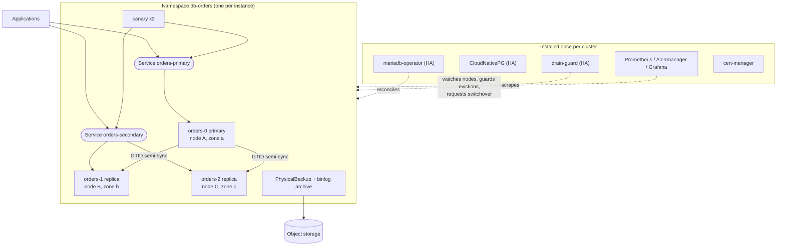

# MariaDB (and PostgreSQL) on Kubernetes — Implementation Plan

| | |
|---|---|
| **Audience** | An autonomous coding agent (executor) and the humans who review its work |
| **Goal** | A repeatable platform that runs many MariaDB instances on Kubernetes, each with one primary and N auto-replicating replicas, never two pods of one instance on the same node, full monitoring and alerting, and no human action needed during Kubernetes upgrades or monthly node rotation. The same contract then extends to PostgreSQL. |
| **Target platform** | Azure Kubernetes Service (AKS), with several database node pools: Premium SSD v2 shapes and local-NVMe shapes. kind is used for all automated tests. |
| **Facts checked on** | 2026-11-17 (operator versions, field names, AKS behaviour; see sections 4 and 10) |

---

## 0. Instructions to the executing agent

Read this whole file before writing anything. Then follow these rules for the entire job.

1. **Work phase by phase, in order** (section 6). Every phase ends with acceptance checks. Do not start the next phase until every check of the current one passes. Commit at the end of each phase with the message `phase N: <title>`.
2. **The CRD schema wins over this document.** Field names here were checked against upstream docs on the date above, but operators move. Before templating any custom resource, dump the installed schema (`kubectl explain <kind>.spec --recursive`) and validate every rendered manifest with `kubectl apply --dry-run=server`. If a field named here does not exist, find the current equivalent in the operator's API reference, use it, and record the change in `docs/deviations.md`.
3. **Pin everything.** Chart versions, image tags and tool versions live only in `versions.yaml`. No `latest` tags. Production images are pinned by digest.
4. **Never commit a secret.** Passwords are generated by the operators or come from pre-existing Kubernetes Secrets referenced by name. Test-only credentials (the object store in kind) live under `environments/kind/` and are clearly marked as such.
5. **Everything is idempotent.** Every `make` target can be run twice in a row with the same result.
6. **Test in kind first.** All acceptance checks run against the local kind cluster built in phase 1. Never apply to a real cluster; staging and production rollout are human-gated (phase 12).
7. **Stop and report instead of guessing** when: an acceptance check cannot be made to pass after a real diagnosis, a required input from section 3 is missing for a non-kind environment, or a step would need a licence or paid service (see MaxScale in section 2.1).
8. **Keep the two engines symmetrical.** Anything engine-neutral (values contract, labels, canary, alerts on canary metrics, scripts, tests) is written once and parameterised by `engine`. Do not fork logic per engine unless the engines truly differ.

---

## 1. Requirements and how each is met

| # | Requirement | Design element | Proven by |
|---|---|---|---|
| R1 | One primary, multiple replicas, replicas replicate automatically | `MariaDB` resource with GTID semi-synchronous replication managed by mariadb-operator; new replicas seed themselves from the latest physical backup | `e2e/topology`, `e2e/scale-out` |
| R2 | Many instances with the same topology | One Helm chart per engine, one small values file per instance, one namespace per instance | `e2e/multi-instance` |
| R3 | Pods of an instance never share a node | Required pod anti-affinity on `kubernetes.io/hostname`, plus zone spread | `e2e/anti-affinity` |
| R4 | Alerting, visualisation, "everything" | Prometheus, Alertmanager, Grafana, per-pod exporters, write canary, logs, runbooks | `e2e/observability`, `promtool test rules` |
| R5 | Same topology for PostgreSQL | CloudNativePG behind the same values contract | all e2e suites re-run with `ENGINE=postgres` |
| R6 | Kubernetes upgrades and monthly node rotation are graceful | One-pod-at-a-time disruption budget, an eviction guard that never lets the primary be evicted, automatic primary evacuation from cordoned nodes, capacity rules, pre-flight and post-flight gates | `e2e/drain`, `e2e/rotation` |

"Graceful" is defined in numbers so it can be tested (section 7.3).

---

## 2. Architecture

### 2.1 Decisions

| # | Decision | Reason |
|---|---|---|
| D1 | **Use operators, not hand-written StatefulSets.** MariaDB: community [mariadb-operator](https://github.com/mariadb-operator/mariadb-operator). PostgreSQL: [CloudNativePG](https://github.com/cloudnative-pg/cloudnative-pg). | Failover, switchover, replica re-seeding and rolling upgrades need a controller that understands replication state. A bare StatefulSet restarts pods; it does not promote replicas. mariadb-operator still renders a StatefulSet (stable identity, one PVC per pod). CloudNativePG manages pods and PVCs directly, by design. |
| D2 | **Default instance = 3 pods: 1 primary + 2 replicas, one per zone.** Minimum allowed is 1 primary + 1 replica. | With semi-synchronous replication and a single replica, every time that replica is drained the primary can stall for up to the acknowledgement timeout. Two replicas make maintenance stall-free and keep redundancy while one pod is away. |
| D3 | **Semi-synchronous GTID replication, wait point `AfterSync`.** | A transaction is acknowledged to the client only after a replica has it, so a failover loses no acknowledged write. If no replica answers within the timeout the primary degrades to asynchronous instead of blocking forever. |
| D4 | **Required anti-affinity per instance on hostname; zone spread; dedicated, tainted database node pools grouped into node classes.** | R3. Anti-affinity is scoped to one instance, so different instances may share a node. A node class is one VM size plus one storage tier (D13). An instance names its node class and runs only there. |
| D5 | **Two storage tiers, chosen per instance through its node class.** `premium-ssd-v2`: Azure Premium SSD v2 through the Azure Disk CSI driver; zonal, re-attachable; the default. `local-nvme`: locally attached NVMe through Microsoft's open-source `local-csi-driver`; fastest; lost with the node. | On Premium SSD v2 a drained pod re-attaches its volume on another node in the same zone and only replays the binlog it missed. On local NVMe a moved pod gets a new, empty volume, so every rotated node costs one replica re-seed from backup. That tier therefore requires at least two replicas, backups and binlog archiving (section 7.5). |
| D6 | **One PodDisruptionBudget per instance, `maxUnavailable: 1`, created by the operator. Never add a second one.** | Only one pod of an instance is ever away voluntarily. mariadb-operator already creates a budget covering all pods of an instance, and the Kubernetes eviction API refuses any pod matched by more than one budget, so an extra "primary" budget would break every drain. |
| D7 | **A small controller, `drain-guard`, makes drains role-aware for MariaDB.** It (a) watches nodes and triggers the operator's planned switchover when a primary sits on a cordoned or draining node, and (b) serves a validating webhook on `pods/eviction` that answers HTTP 429 for the current primary, so every drain tool waits and retries exactly as it does for a budget. | Managed node-pool upgrades cordon and drain on their own; nobody can run a manual step in between. CloudNativePG does both natively (separate budget for the primary, switchover ahead of the drain). The community MariaDB operator documents failover after the primary is lost and a declarative switchover, but no drain-triggered switchover; the Enterprise edition has one, through MaxScale. Strimzi's Drain Cleaner uses the same webhook pattern for Kafka. |
| D8 | **One namespace per instance, `db-<name>`.** | Clean scoping for budgets, network policy, quotas, RBAC and metrics (`namespace` is the instance key in every alert). |
| D9 | **Applications connect to two stable Services: `<name>-primary` (read-write) and `<name>-secondary` (read-only).** | Same contract for both engines. The operator repoints the Services on every role change. |
| D10 | **MaxScale is off by default.** | It gives transparent failover, transaction replay and read-write splitting, but it is under the Business Source License. Check the licence terms for the pinned version before production use. Enabling it is a human decision; the chart only carries the switch. |
| D11 | **Observability is kube-prometheus-stack plus a per-instance write canary.** | Exporter metrics say what the server thinks; the canary says what a client experiences. The canary is also the measuring instrument for every "graceful" acceptance test. |
| D12 | **Helm charts + Helmfile; optional Argo CD ApplicationSet.** | No in-cluster dependency for bootstrap and CI; GitOps can be layered on without changing the charts. |
| D13 | **The target is AKS. Each node class is one node pool per availability zone**, all pools of a class carrying the same labels and taint. Database pools upgrade with surge 1, a long drain timeout and `--undrainable-node-behavior Cordon`. | Zonal disks with the cluster autoscaler need one pool per zone (Microsoft's recommendation), and it also makes the surge node appear in the zone of the node being replaced. AKS's default for a node whose drain is blocked is to delete it and surge a replacement, which would kill a database pod; `Cordon` quarantines the node instead. |

### 2.2 Platform overview



### 2.3 What one instance consists of

Everything below is rendered by the instance chart into `db-<name>`:

- `MariaDB` (or CloudNativePG `Cluster`): the pods, PVCs, Services, replication.
- One PodDisruptionBudget (created by the operator from the resource's own settings).
- `PhysicalBackup` (scheduled), `PhysicalBackup` template for replica seeding, `PointInTimeRecovery` (binlog archive).
- `Database`, `User`, `Grant` resources for application schemas.
- `ServiceMonitor`/`PodMonitor`, `PrometheusRule`, canary Deployment.
- `NetworkPolicy`.

The namespace itself, with its labels and quota, comes from the small `db-namespace` chart, released just before the instance.

### 2.4 What happens when a node is drained

This sequence is the core of R6. It is identical for a Kubernetes upgrade, a monthly image rotation, an autoscaler scale-down and a manual `kubectl drain`.

1. The node is cordoned (or receives a disruption taint from the autoscaler).
2. `drain-guard` sees that the node hosts the primary of instance X. It picks the best healthy replica on a schedulable node and patches `spec.replication.primary.podIndex`. (For PostgreSQL, CloudNativePG does this step itself.)
3. Meanwhile the drain tries to evict the primary pod. The eviction guard answers "not now" (HTTP 429), and also requests the switchover if step 2 has not happened yet. Every drain tool retries on 429.
4. The operator runs a planned switchover: lock writes, wait for the chosen replica to catch up, promote it, repoint the Services, demote the old primary. Writes pause for a few seconds; nothing is lost.
5. The old primary is now a replica, so the guard lets its eviction through. The instance's budget allows it as long as no other pod of X is away.
6. The pod is rescheduled on another node of its node class in the same zone. On Premium SSD v2 it re-attaches its volume and catches up through GTID. On local NVMe it starts on a new, empty volume, restores the latest backup, then catches up. Only when it is Ready does the budget allow the next eviction for X.
7. Replicas on drained nodes follow steps 5 and 6 directly.

If no healthy replica exists, nothing is switched, the guard keeps refusing the eviction, and an alert pages a human. If `drain-guard` itself is down, evictions of MariaDB pods are refused. The platform fails closed: a drain may wait, but a primary is never killed by one.

---

## 3. Inputs and assumptions

The agent builds and tests everything on kind with the defaults below. Real environments override them in `environments/<env>/platform.yaml`. Inputs marked **required** have no safe default outside kind.

| Input | Default (kind) | Notes |
|---|---|---|
| `kubernetesVersion` | 1.34 or newer | mariadb-operator needs 1.31+; CloudNativePG 1.30 supports 1.34 to 1.36. |
| `cloud` | `kind` | `aks` for real clusters. |
| `zones` | `zone-a`, `zone-b`, `zone-c` (node labels in kind) | Production: the three availability zones of the AKS region. |
| `nodeClasses` | two emulated classes, `kind-pv2` and `kind-nvme` | **Required.** The catalogue of database node shapes (section 7.5): one entry per VM size and storage tier. The node pools themselves are created outside this repository, with the labels and taint listed there. |
| `storageClasses` | `db-pv2` and `db-nvme`, both backed by the local-path provisioner in kind | On AKS, `db-pv2` uses `disk.csi.azure.com` with `skuName: PremiumV2_LRS`, `cachingMode: None` and per-class IOPS and throughput; `db-nvme` uses `localdisk.csi.acstor.io`. All use `WaitForFirstConsumer`. |
| `localNvme.driver` | `none` | `helm` installs Microsoft's open-source local-csi-driver chart. `aks-addon` expects Azure Container Storage to be enabled on the cluster already (`az aks update --enable-azure-container-storage`). Only one instance of the driver may run per cluster. |
| `objectStore` | in-cluster S3-compatible test store | **Required**: on AKS an Azure Blob Storage container, or an S3-compatible endpoint, plus a Secret name holding credentials (or workload identity). Both operators document Azure Blob for backups; phase 5 confirms it also works for binlog archiving before relying on it. |
| `monitoring.install` | `true` | Set `false` if the cluster already runs kube-prometheus-stack; then set `monitoring.prometheusRelease` to its release label. |
| `alerting.receivers` | a webhook sink in kind | **Required**: Secret names for the chat webhook (warnings) and the paging integration key (critical), plus a dead-man's-switch URL. |
| `imageRegistry` | images loaded into kind | **Required**: registry for the two images built in this repo (`drain-guard`, `db-canary`). |
| `gitops` | `helmfile` | `argocd` switches on the ApplicationSet in phase 4. |
| `labelDomain` | `dbaas.local` | Prefix for platform labels and annotations. |

Assumptions the agent must not silently change:

- Applications reconnect and retry on connection loss. A planned switchover closes connections to the old primary.
- Every node class has, in every zone, room for one more database pod than it currently runs (phase 9, capacity rule).
- Cluster administrators can install CRDs and cluster-scoped RBAC.

---

## 4. Version pins

Put these in `versions.yaml`. At implementation time, bump each to the newest patch release of the same line, read its release notes, and record what changed in `docs/deviations.md`.

| Component | Pin | Notes |
|---|---|---|
| Kubernetes (test cluster) | `v1.36.4` | Inside the supported range of both operators. Used for the kind node image, kubectl and manifest schemas. |
| mariadb-operator | `26.10.2` | Skip `26.10.0` (upstream says so). Upgrade one release at a time, never skipping. Charts are OCI: `oci://ghcr.io/mariadb-operator/charts/{mariadb-operator-crds,mariadb-operator}`. API group `k8s.mariadb.com/v1alpha1`. Works only with official MariaDB images. |
| MariaDB server | `11.8` LTS | Must be 10.8+ for point-in-time recovery. Use the newest LTS the pinned operator supports. |
| CloudNativePG | `1.30.1` (chart `0.29.1`) | `oci://ghcr.io/cloudnative-pg/charts/cloudnative-pg`. PostgreSQL 15 to 18 supported. |
| Barman Cloud Plugin | `0.16.0` (chart `0.9.0`) | The built-in Barman support is deprecated and is removed within the next two minor releases. Use the plugin from day one. Needs cert-manager. |
| PostgreSQL | `18` | |
| kube-prometheus-stack | `82.16.0` | `oci://ghcr.io/prometheus-community/charts/kube-prometheus-stack`. |
| cert-manager | `v1.21.3` | `oci://quay.io/jetstack/charts/cert-manager`. |
| local-csi-driver | `0.4.1` | AKS local NVMe tier. `oci://localcsidriver.azurecr.io/acstor/charts/local-csi-driver`. |
| Tools | see the `tools` block of `versions.yaml` | Helm 4, helmfile, helm-unittest, kubectl, kind, kubeconform, promtool, yq, pluto, yamllint, shellcheck. `make tools` installs them into `.bin/`; `make tools-check` verifies each against its pin. |

---

## 5. Repository layout

```
.
├── PLAN.md
├── Makefile
├── versions.yaml                  # single source of truth for all pins
├── hack/                          # developer tooling: tool installer, lint and schema scripts, self-tests
├── helmfile.d/
│   ├── 00-platform.yaml.gotmpl    # cert-manager, monitoring, operators, drain-guard, storage, priority classes
│   └── 10-instances.yaml.gotmpl   # one release per file in environments/<env>/instances/
├── environments/
│   ├── kind/      { platform.yaml, kind-cluster.yaml, instances/*.yaml }   # platform.yaml holds the node class catalogue
│   ├── staging/   { platform.yaml, instances/*.yaml }
│   └── prod/      { platform.yaml, instances/*.yaml }
├── charts/
│   ├── db-common/                 # library chart: names, labels, NetworkPolicy, canary, rule helpers
│   ├── db-namespace/              # labelled Namespace, quota (released before each instance)
│   ├── mariadb-instance/
│   ├── postgres-instance/
│   ├── db-platform-base/          # StorageClasses, PriorityClasses, admission policies, shared dashboards and rules
│   └── drain-guard/
├── tools/                         # one Go module
│   ├── db-canary/                 # write/read canary and verifier (phase 6)
│   └── drain-guard/               # controller and eviction webhook (phase 7)
├── gitops/argocd/                 # optional ApplicationSet (phase 4)
├── dashboards/                    # Grafana JSON, provisioned as ConfigMaps
├── alerts/
│   ├── rules/                     # shared PrometheusRule sources
│   └── tests/                     # promtool unit tests
├── scripts/
│   ├── preflight.sh  postflight.sh  rotate-nodes.sh  aks-rotate-pools.sh  switchover.sh  restore-drill.sh
│   └── lib.sh
├── tests/e2e/                     # bash suites, one per name in section 1, engine-parameterised
├── docs/
│   ├── architecture.md  operations.md  node-rotation.md  kubernetes-upgrade.md
│   ├── app-developer-guide.md  deviations.md  compat-matrix.md
│   └── runbooks/<AlertName>.md
└── .github/workflows/ci.yaml
```

---

## 6. Phases

Each phase lists its goal, its steps and its acceptance checks. Acceptance checks are scripted; "passes" means the script exits 0 on a freshly built kind cluster.

### Phase 0 — Scaffold and tooling

**Goal:** an empty but lint-clean repository with one command per job, and a lint pipeline that is proven able to fail.

1. Create the layout from section 5 and `versions.yaml` from section 4. Empty directories carry a `.gitkeep`.
2. `make tools` (`hack/install-tools.sh`) installs every pinned tool into `.bin/`, idempotently. Go tools are built from their pinned module version through the Go module proxy, which checks every download against the Go checksum database; yamllint and shellcheck come from PyPI into a private virtualenv; kubectl comes from `dl.k8s.io` and is checked against its published SHA-256. `make tools-check` verifies every tool against its pin and lists host prerequisites.
3. Write the `Makefile`. Required targets: `tools`, `tools-check`, `schemas`, `lint`, `unit`, `verify` (lint + unit), `images`, `kind-up`, `kind-down`, `platform-up`, `instances-up`, `e2e` (all suites), `e2e-<suite>`, `instance-new`. Every target reads `ENV` (default `kind`) and `ENGINE` (default `mariadb`) and rejects unknown values. A target whose phase has not been built yet fails with a message naming that phase; it never succeeds silently.
4. `make schemas` (`hack/gen-crd-schemas.sh`) generates strict JSON Schemas into `.cache/schemas/` from the CRDs listed under `crdSources` in `versions.yaml`: mariadb-operator, CloudNativePG, the Barman Cloud Plugin and prometheus-operator, each fetched at the tag of its pinned version. Strict means an undeclared field is an error. Later phases add a source when a chart starts rendering a new kind.
5. `make lint` runs: yamllint; shellcheck; for every chart `helm lint --strict` and `helm template` with every example values file in `<chart>/ci/*.yaml`, piped into kubeconform (`hack/lint-charts.sh`); `promtool check rules`; `go vet`. kubeconform never ignores a missing schema, and an application chart without an example values file is an error.
6. `make unit` runs: the tooling self-test (`hack/selftest.sh`); helm-unittest; `promtool test rules`; `go test ./...`. The self-test validates the reference manifests of this plan (`hack/testdata/manifests/valid/`) against the pinned CRD schemas, and requires that each manifest in `hack/testdata/manifests/invalid/` is rejected for the stated reason. If a reference manifest stops validating after a version bump, fix the plan and the charts, not the test.
7. Add `.github/workflows/ci.yaml`: `make tools tools-check verify` on every push and pull request; `e2e` as a matrix over `ENGINE`; `rotation` and `chaos` nightly. The e2e jobs are skipped until suites exist under `tests/e2e/`.
8. Create `docs/deviations.md` (empty table: date, phase, what the plan said, what was done, why).

**Acceptance:** on a clean checkout, `make tools` followed by `make tools-check verify` exits 0; the self-test reports every valid manifest accepted and every invalid one rejected; the CI `verify` job is green.

### Phase 1 — Test cluster and platform base

**Goal:** a kind cluster that looks like the AKS target from the scheduler's point of view, with two database node classes, monitoring, certificates, storage classes and a test object store.

1. `environments/kind/kind-cluster.yaml`: one control-plane node; two workers labelled `pool=system`; six database workers, three per emulated node class (`kind-pv2`, `kind-nvme`), one per zone. Database workers carry `workload=database`, `dbaas.local/node-class=<class>`, `dbaas.local/storage-tier=<tier>`, `topology.kubernetes.io/zone=zone-a|zone-b|zone-c` and the taint `workload=database:NoSchedule`. `make kind-up` is idempotent. `KIND_NODE_CLASSES` may restrict the cluster to one class on small machines. The cluster's network plugin must enforce NetworkPolicy; if the pinned kind version's default does not, install one that does.
2. Chart `db-platform-base`:
   - One StorageClass per entry of `storageClasses` in `environments/<env>/platform.yaml` (section 7.5). In kind both tiers use the local-path provisioner. On AKS the chart renders the Azure Disk and local-csi-driver classes described in section 3. Every class uses `WaitForFirstConsumer`.
   - PriorityClasses `dbaas-database` (1000000) and `dbaas-platform` (900000). Neither is the global default.
   - Namespaces `dbaas-system` and `monitoring`.
   - A `values.schema.json` that validates the node class and storage class catalogues, so a broken `platform.yaml` fails `make lint`.
3. `helmfile.d/00-platform.yaml.gotmpl` installs, in order: cert-manager; kube-prometheus-stack (only if `monitoring.install`); an S3-compatible test object store with one bucket (kind only); the local-csi-driver chart (only if `localNvme.driver: helm`); `db-platform-base`.
4. kube-prometheus-stack values: let Prometheus select ServiceMonitors, PodMonitors and PrometheusRules from all namespaces; enable the Grafana dashboard sidecar for all namespaces with label `grafana_dashboard: "1"` and folder annotation support; enable the kube-state-metrics custom-resource-state config (filled in phase 8); persistent storage and retention are per-environment values.
5. Platform components run on `pool=system` nodes with `dbaas-platform` priority. Nothing but databases tolerates the database taint.

**Acceptance:** all platform pods Ready; `db-pv2` and `db-nvme` exist; every database node carries its node-class and storage-tier labels; Prometheus reports its own targets up; Grafana `/api/health` answers through a port-forward; the test bucket exists; a second `make kind-up platform-up` changes nothing.

### Phase 2 — MariaDB operator

**Goal:** a highly available operator, because an operator that is down cannot fail anything over.

1. Install `mariadb-operator-crds`, then `mariadb-operator`, into `mariadb-system`, at the pinned version, from the OCI registry.
2. Values (names verified against chart 26.10.2):

   ```yaml
   ha:             { enabled: true, replicas: 3 }      # 2 in kind (two system nodes)
   pdb:            { enabled: true, maxUnavailable: 1 }
   webhook:
     ha:           { enabled: true, replicas: 3 }
     pdb:          { enabled: true, maxUnavailable: 1 }
   certController:
     ha:           { enabled: true, replicas: 3 }
     pdb:          { enabled: true, maxUnavailable: 1 }
   metrics:        { enabled: true, serviceMonitor: { enabled: true } }
   priorityClassName: dbaas-platform
   nodeSelector:   { pool: system }
   affinity:       # required anti-affinity on kubernetes.io/hostname for controller, webhook and cert-controller
   ```
3. Write `docs/compat-matrix.md`: for each pinned operator, the Kubernetes versions and server versions it supports, with the source link. Phase 9 reads this file before any cluster upgrade.

**Acceptance:** controller, webhook and cert-controller each have at least two Ready replicas on different nodes; `kubectl get crd mariadbs.k8s.mariadb.com` succeeds; deleting the leader pod leaves a working operator within 30 seconds (a trivial `MariaDB` dry-run apply still passes the webhook).

### Phase 3 — The `mariadb-instance` chart

**Goal:** one Helm release gives one complete instance: 1 primary, N replicas, replicating, spread across nodes and zones. This phase covers R1 and R3.

1. Implement the values contract of section 7.1 with a `values.schema.json` that rejects: `replicas < 1`, names not matching `^[a-z][a-z0-9-]{1,28}[a-z0-9]$`, a missing `nodeClass` or storage size, unknown keys. Helmfile passes the environment's node class and storage class catalogues to the chart. The templates fail with a clear message on an unknown node class, on a storage class of another tier, and on any violation of the tier rules in section 7.5.
2. Chart `db-namespace`: a `Namespace` named `db-<name>` with labels `dbaas.local/managed: "true"`, `dbaas.local/engine: <engine>`, `dbaas.local/instance: <name>`, and an optional `ResourceQuota`. In kind it also creates the test object-store Secret.
3. Render the `MariaDB` resource. Reference shape (field names verified against the 26.10 docs; rule 2 of section 0 still applies):

   ```yaml
   apiVersion: k8s.mariadb.com/v1alpha1
   kind: MariaDB
   metadata:
     name: orders
     namespace: db-orders
   spec:
     image: docker-registry1.mariadb.com/library/mariadb:11.8.<patch>   # by digest in prod
     replicas: 3                       # = 1 primary + .Values.replicas
     rootPasswordSecretKeyRef: { name: orders-root, key: password, generate: true }
     storage:
       size: 100Gi
       storageClassName: db-pv2        # from the node class
       resizeInUseVolumes: true
       waitForVolumeResize: true
     resources:
       requests: { cpu: "2", memory: 8Gi }
       limits:   { memory: 8Gi }       # memory request = limit, always
     replication:
       enabled: true
       gtidStrictMode: true
       semiSyncEnabled: true
       semiSyncWaitPoint: AfterSync    # the default is AfterCommit; AfterSync is deliberate (D3)
       semiSyncAckTimeout: 10s
       syncBinlog: 1
       primary:
         autoFailover: true
         # podIndex is deliberately absent, see step 4
       replica:
         gtid: CurrentPos
         syncTimeout: 10s
         # bootstrapFrom and recovery are added in phase 5
     affinity:
       podAntiAffinity:
         requiredDuringSchedulingIgnoredDuringExecution:
           - topologyKey: kubernetes.io/hostname
             labelSelector:
               matchLabels: { app.kubernetes.io/instance: orders }
     topologySpreadConstraints:
       - maxSkew: 1
         topologyKey: topology.kubernetes.io/zone
         whenUnsatisfiable: DoNotSchedule
         labelSelector:
           matchLabels: { app.kubernetes.io/instance: orders }
     nodeSelector: { dbaas.local/node-class: pv2-e8 }   # from .Values.nodeClass
     tolerations:
       - { key: workload, operator: Equal, value: database, effect: NoSchedule }
     priorityClassName: dbaas-database
     terminationGracePeriodSeconds: 300
     podDisruptionBudget: { maxUnavailable: 1 }
     updateStrategy:
       type: ReplicasFirstPrimaryLast
       autoUpdateDataPlane: true       # false in prod, see docs/operations.md "operator upgrade"
     tls: { enabled: true, required: true }
     metrics:
       enabled: true
       serviceMonitor: { prometheusRelease: kube-prometheus-stack, interval: 15s, scrapeTimeout: 10s }
     myCnf: |
       # rendered from section 7.4
   ```
4. Rules for this template:
   - **Never render `spec.replication.primary.podIndex`.** The operator and `drain-guard` own it. Never run `helm upgrade --force`. For Argo CD, add an `ignoreDifferences` entry for that path.
   - Write the anti-affinity rule explicitly, as above. Do not rely on `affinity.antiAffinityEnabled`; its docs do not say whether it is required or preferred.
   - Check the labels the operator really puts on database pods and make the selectors match those pods and nothing else (not the metrics exporter, not backup jobs). The test in this phase asserts the selector returns exactly `spec.replicas` pods.
   - Leave `replica.maxLagSeconds` at the upstream default of 0 and expose it as a value. Per the CRD, a replica over the limit is marked not Ready, is not a failover candidate, and blocks switchovers and upgrades. Not Ready counts as "away" for the budget, which is what stops a drain from taking the last healthy replica. If replicas flap under write load in staging, raise it per instance rather than globally.
   - On the `local-nvme` tier, add the annotation `localdisk.csi.acstor.io/accept-ephemeral-storage: "true"` to the volume claim template (through `spec.storage.volumeClaimTemplate`). Without it the driver refuses persistent claims.
   - When `deletionProtection` is true (the default) annotate the `MariaDB` resource with `helm.sh/resource-policy: keep`.
5. Render `Database`, `User` and `Grant` resources from `access.databases`. Application passwords are generated into Secrets; the chart never contains one.
6. Applications use `<name>-primary` and `<name>-secondary` in `db-<name>`. Write this, with TLS, timeout, retry and pool guidance, into `docs/app-developer-guide.md`.
7. helm-unittest cases: total pod count is `1 + replicas`; the anti-affinity term is `required` on hostname; the node selector and storage class follow the node class; the NVMe annotation appears only on that tier; each tier rule of section 7.5 fails the render when broken; `podIndex` is never rendered; the budget is `maxUnavailable: 1`; TLS is required; the schema rejects bad input.
8. Write `tests/e2e/lib.sh` (helpers such as `wait_instance_ready`, `primary_pod`, `replica_pods`, `sql_on`, `node_of`, `zone_of`) so that suites never contain engine-specific commands.

**Acceptance — `e2e/topology`:**
- The instance reports Ready.
- Exactly one pod is the primary; every other pod is a replica with both replication threads running, using GTID, and read-only.
- Semi-sync is active on the primary.
- A row written through `<name>-primary` is readable through `<name>-secondary` within 5 seconds.
- A write through `<name>-secondary` fails.
- A non-TLS client connection is refused.

**Acceptance — `e2e/anti-affinity`:**
- Every pod of the instance is on a different node and in a different zone, and only on nodes of its node class.
- On a throwaway instance, scaling to one more pod than its node class has nodes leaves the extra pod Pending with an anti-affinity scheduling event, even though nodes of the other class are free; scaling back removes it. The existing pods are untouched throughout.

### Phase 4 — Many instances

**Goal:** adding an instance is adding one file. This phase covers R2.

1. `environments/<env>/instances/<name>.yaml` holds the values of one instance, including `engine`.
2. `helmfile.d/10-instances.yaml.gotmpl` loops over those files. For each it emits two releases: `ns-<name>` (chart `db-namespace`, in `dbaas-system`) and `<name>` (chart `<engine>-instance`, in `db-<name>`, with `needs` on the first).
3. Sizes: the chart carries presets `small`, `medium`, `large` (CPU, memory, storage, connection limit). A values file may name a preset and override single fields.
4. `make instance-new NAME=<name> ENGINE=<engine> SIZE=<size>` writes a new values file from a template and validates it against the schema.
5. If `gitops: argocd`, add `gitops/argocd/applicationset.yaml`: a git-files generator over the same directory, `managedNamespaceMetadata` for the namespace labels, `ignoreDifferences` for the primary index, automated sync without pruning of instances.
6. In `db-platform-base`, add ValidatingAdmissionPolicies for namespaces labelled `dbaas.local/managed=true`. A `MariaDB` must have replication enabled, at least 2 pods, and a required hostname anti-affinity term. (The PostgreSQL equivalent is added in phase 10.) This protects the guarantees from hand-made resources.

**Acceptance — `e2e/multi-instance`:**
- Two instances, `alpha` and `beta`, created in the same run, both become Ready and both pass `e2e/topology`.
- Pods of `alpha` and `beta` may share nodes; within each instance all nodes differ.
- A third instance on the other node class lands only on that class's nodes and uses that tier's storage class.
- Removing `alpha` from the directory and syncing leaves `beta` untouched, and leaves `alpha`'s `MariaDB` resource and volumes in place (deletion protection). The documented two-step removal then deletes it.
- A values file with `replicas: 0` is rejected by `make lint`.
- A hand-written single-pod `MariaDB` applied to a managed namespace is rejected by the admission policy.

### Phase 5 — Backups, point-in-time recovery, self-seeding replicas

**Goal:** replicas build and repair themselves, and any instance can be restored to any second inside the retention window.

1. Scheduled `PhysicalBackup` per instance: `mariaDbRef`, `schedule.cron`, `compression`, `maxRetention` (default `720h`), `target` set to prefer a replica, `storage.s3` or `storage.azureBlob` filled from `backup.objectStore`. The credentials Secret is referenced by name only.
2. A second `PhysicalBackup` used as a template, referenced from `spec.replication.replica.bootstrapFrom.physicalBackupTemplateRef`. With it, a new or emptied replica restores the newest backup and then catches up through GTID, with no load on the primary beyond the binlog it streams. On the `local-nvme` tier this is not an exception path: it runs for every pod that a drain or a node loss moves.
3. `spec.replication.replica.recovery: { enabled: true, errorDurationThreshold: 5m }` so a replica with an unrecoverable replication error is rebuilt automatically.
4. `PointInTimeRecovery` per instance (binlog archive to the same bucket under another prefix), linked through `spec.pointInTimeRecoveryRef`. Needs MariaDB 10.8 or newer.
5. Keep binlogs on disk for 7 days (`binlog_expire_logs_seconds`), so a replica that was away for hours during maintenance catches up without a re-seed.
6. `scripts/restore-drill.sh <instance> [timestamp]`: creates a throwaway instance from `spec.bootstrapFrom.pointInTimeRecoveryRef` and `targetRecoveryTime`, checks a known marker table and row counts, deletes the throwaway. Ship it as a weekly CronJob in `dbaas-system`; its last success time is the metric behind the `DbRestoreDrillStale` alert.
7. Expose backup age as a metric. Use kube-state-metrics custom-resource-state on the `PhysicalBackup` status if it carries a completion time; otherwise use the job metrics kube-state-metrics already has. Record the choice in `docs/deviations.md`.
8. Runbooks in `docs/operations.md`: restore to a point in time, rebuild one replica, change the backup schedule.

**Acceptance — `e2e/scale-out`:** on an instance that starts with `replicas: 1`, raising it to 2 produces a new replica that seeds from the backup, joins replication and becomes Ready with no manual step. Lowering it again removes the pod and leaves the others untouched. (Each kind node class has three nodes, so three pods is the most one instance can run there.)

**Acceptance — `e2e/backup-restore`:**
- An on-demand backup completes and its object exists in the bucket.
- Deleting one replica's pod and volume claim leads to an automatic re-seed and rejoin. Run this on both node classes; it is the kind stand-in for a local-NVMe pod that came back on an empty volume.
- Point in time: write marker A, note the time, write marker B. Restore to the noted time into a new instance. A is present, B is absent.
- `scripts/restore-drill.sh` exits 0.

### Phase 6 — The canary (measuring instrument)

**Goal:** a client's-eye measurement of availability and durability. Every "graceful" claim from here on is checked with it. It is engine-neutral.

1. `tools/db-canary`, in Go, with drivers for MySQL protocol and PostgreSQL. Behaviour:
   - Every second (configurable), with a 2-second timeout, insert `(writer, seq, ts)` into `dbaas_canary.heartbeat` through the primary Service. `writer` is the pod name; `seq` increases by one per acknowledged or failed attempt.
   - Every second, read the newest `ts` through the secondary Service and compute the delay a reader sees.
   - Behave like a well-written application: connection pool, bounded connection lifetime, drop and redial on error. No special failover logic.
   - Remember which `seq` values were acknowledged. On request, compare them with the rows actually present and count acknowledged writes that are missing.
   - Prune rows older than one hour.
2. Prometheus metrics: `db_canary_write_total{result}`, `db_canary_write_duration_seconds` (histogram), `db_canary_read_total{result}`, `db_canary_replica_delay_seconds`, `db_canary_last_write_success_timestamp_seconds`, `db_canary_longest_write_outage_seconds`, `db_canary_lost_acked_writes`.
3. HTTP endpoints for tests: `GET /report` (JSON: attempts, failures, longest consecutive write outage in seconds, lost acknowledged writes, same for reads) and `POST /reset`.
4. Deployment template in `db-common`, used by both instance charts: 2 replicas on `pool=system` nodes (so database node drains do not disturb the instrument), its own least-privilege database user created declaratively through the engine's operator, a PodMonitor.
5. Unit tests with a fake driver: outage accounting, lost-write detection, reconnect behaviour.

**Acceptance — `e2e/failover`:** with the canary running, force-delete the primary pod. A new primary serves within 60 seconds, the old one rejoins as a replica, and the report shows a longest write outage of at most 60 seconds and zero lost acknowledged writes.

### Phase 7 — Graceful disruptions: budget, `drain-guard`, shutdown

**Goal:** any node can be drained at any time, by any tool, with no human step, and the primary is never killed by a drain. This is the core of R6.

**Step 0 — check for a native feature first.** Read the release notes and docs of the pinned mariadb-operator for a drain-triggered or shutdown-triggered primary switchover. If it exists, enable it, skip steps 2 to 4, keep steps 1, 5, 6 and the whole acceptance suite, and record this in `docs/deviations.md`. As of 26.10.2 the community docs describe none.

**Step 1 — the budget.** Keep `spec.podDisruptionBudget: { maxUnavailable: 1 }` from phase 3. Add a test that exactly one PodDisruptionBudget selects each database pod. Add a lint rule that fails if any chart in this repository renders another budget selecting database pods (D6).

**Step 2 — `drain-guard` controller** (`tools/drain-guard`, Go, controller-runtime, leader election).

- *Scope:* `MariaDB` resources in namespaces labelled `dbaas.local/engine=mariadb`.
- *A node is "draining"* if `spec.unschedulable` is true or it carries a taint whose key is in a configurable list. Defaults: `node.kubernetes.io/unschedulable`, `ToBeDeletedByClusterAutoscaler`, `karpenter.sh/disrupted`. Document how to add provider-specific keys.
- *Reconcile trigger:* node changes, pod changes, `MariaDB` changes, and a 30-second resync.
- *Evacuate(instance)* runs when the current primary's node is draining:
  1. Do nothing if a switchover or failover is already pending or running (desired primary index differs from current, or the resource's conditions say so), or if an evacuation for it was requested in the last 60 seconds.
  2. Candidates are replica pods that are Ready and on nodes that are not draining.
  3. Order candidates by: node with the newest kubelet version, then newest node creation time, then lowest pod index. Freshly rotated nodes are the youngest, so during a rolling replacement the primary normally moves once, at most twice.
  4. Patch `spec.replication.primary.podIndex` to the winner. If the instance uses MaxScale (`spec.maxScaleRef` is set), request the switchover through the `MaxScale` resource instead (`spec.primaryServer`).
  5. Emit a Kubernetes Event on the `MariaDB` resource and update metrics.
  6. With no candidate, emit a Warning event, set the "blocked" gauge, and retry on the next reconcile.
- *Read current and desired primary from the `MariaDB` resource*, not from pod labels: `status.currentPrimary`, `status.currentPrimaryPodIndex`, per-pod roles in `status.replication.roles`, and the desired index in `spec.replication.primary.podIndex`.

**Step 3 — eviction webhook** (same binary).

- `ValidatingWebhookConfiguration`: operation `CREATE` on resource `pods/eviction`, `namespaceSelector` `dbaas.local/engine=mariadb`, `failurePolicy: Fail`, `timeoutSeconds: 5`, `sideEffects: NoneOnDryRun`. Serving certificate from cert-manager.
- Decision, using a live (uncached) read of the owning `MariaDB`:
  - Pod is not a database pod of a managed instance: allow.
  - Pod is the current primary, or the desired primary, or a switchover is in progress for the instance: deny with status code 429 and reason `TooManyRequests`, message naming the instance. Unless the request is a dry run, call Evacuate(instance).
  - Otherwise: allow. The instance's budget then decides.
- 429 matters. `kubectl drain`, cluster-autoscaler, Karpenter and the managed node-group upgraders all treat 429 as "retry later". Any other denial code aborts `kubectl drain`.
- Fail closed: if the webhook is unreachable, the API server rejects evictions in MariaDB namespaces (including the exporter and canary pods there; that is accepted). That delays a drain; it never hurts a database.

**Step 4 — deploy `drain-guard`** (chart `drain-guard`, namespace `dbaas-system`): 3 replicas (2 in kind) on `pool=system`, required hostname anti-affinity, its own budget (`maxUnavailable: 1`), `dbaas-platform` priority, a `preStop` sleep of a few seconds so endpoints update before the process exits, readiness tied to the webhook server. RBAC: read nodes and pods; read and patch `mariadbs` (and `maxscales` if used); create events; leases. Metrics: `drain_guard_evacuations_total{namespace,result}`, `drain_guard_evictions_denied_total{namespace,reason}`, `drain_guard_blocked_instances`, `drain_guard_evacuation_duration_seconds`.

**Step 5 — clean shutdown.**
- `terminationGracePeriodSeconds: 300` (values-driven). It must be shorter than the node pool's drain timeout.
- `innodb_buffer_pool_dump_at_shutdown` and `innodb_buffer_pool_load_at_startup` on, so a rescheduled pod is warm quickly.
- Parallel replication on replicas, so a returning replica catches up fast and the budget reopens sooner.
- A statement time limit for application users (`maxStatementTimeSeconds`, default 300 in prod). A planned switchover waits for running statements; one unbounded query would otherwise hold up a drain.

**Step 6 — manual switchover.** `scripts/switchover.sh <instance> [target-pod]` patches the primary index, waits for completion, prints the canary report. Document it in `docs/operations.md`.

**Unit tests** (fake client or envtest): draining detection for each taint; candidate ordering; every guard in Evacuate; webhook decisions including dry run, non-database pods, unknown pods, and the mid-switchover case; the 429 response shape.

**Acceptance — `e2e/drain`.** Every case uses plain `kubectl drain --ignore-daemonsets --delete-emptydir-data`, never `--force`, never `--disable-eviction`. Reset the canary before each case. In kind, volumes are node-local, so "node replaced" is simulated per tier. On the `kind-pv2` class: drain, wait, uncordon (the data survives, as with a re-attached disk). On the `kind-nvme` class: drain, delete the evicted pod's volume claim, uncordon (the data is gone, as on a new node). Run every case on both classes.

| Case | Action | Must hold |
|---|---|---|
| a | Drain a node holding a replica | Zero canary write failures. `<name>-secondary` keeps at least one endpoint. While that replica is away, evicting the other replica is refused. |
| b | Drain the node holding the primary | The drain finishes by itself. The role moved before the old primary pod was deleted (compare event times). Longest write outage within the section 7.3 limit. Zero lost acknowledged writes. |
| c | Drain the primary's node while one replica is away (its node drained first) | The primary is never evicted while it holds the role. The old primary's eviction waits until the other replica is Ready again; the drain then completes within case b's limits. Record whether the operator switched over before or after the replica returned. |
| d | Cordon every database node, then drain the primary's node (no candidate exists) | The drain stays blocked and nothing is switched. `drain_guard_blocked_instances` is 1. After the other nodes are uncordoned the drain completes. |
| e | Scale `drain-guard` to zero, then drain | The drain command fails with a webhook error and no database pod is deleted. After scaling back, a new drain finishes. |
| f | Server-side dry-run eviction of the primary | Refused, and no switchover is triggered. |
| g | Two instances with primaries on the same node | Both are evacuated; the drain completes; both pass case b's limits. |
| h | Roll the image tag of an instance | Replicas restart first, one planned switchover, then the old primary. Same limits as case b. |
| i | `kind-nvme` only: drain the primary's node and discard its volume | Switchover first, as in case b. The old primary then comes back empty, re-seeds from the backup and rejoins as a replica with no manual step. No other pod of the instance is evicted until it is Ready. |

### Phase 8 — Observability

**Goal:** R4. An operator on call can see fleet health at a glance, is paged only for things that need a human, and lands on a runbook.

**8.1 Metric sources**

| Source | Gives |
|---|---|
| mysqld_exporter (deployed by the operator through `spec.metrics`) | Server and replication state per pod |
| Operator metrics | Reconcile errors, operator liveness |
| kube-state-metrics | Pod, node, budget, job and volume-claim state; plus custom-resource-state for `MariaDB` (Ready condition, current primary) and backups |
| kubelet | Volume usage (`kubelet_volume_stats_*`) |
| `db-canary` | What clients experience |
| `drain-guard` | Evacuations, denied evictions, blocked drains |

Confirm every metric name used in a rule or panel against a live scrape in kind. Exporter metric names differ between versions.

**8.2 Alert rules.** Implement the catalogue in section 7.2. Shared rules live in `alerts/rules/` and ship with `db-platform-base`; per-instance thresholds come from instance values. Every alert has `severity`, `summary`, `description`, `runbook_url` (a file in `docs/runbooks/`) and `dashboard_url`. Every alert has a `promtool` unit test in `alerts/tests/` with a firing and a non-firing series.

The design rule for alerts: **a healthy drain must not page.** One replica away for a few minutes and one switchover are normal. Pages are for client-visible unavailability, redundancy lost for longer than a drain cycle, risk of data loss, and maintenance that is stuck.

**8.3 Dashboards** (`dashboards/*.json`, provisioned as ConfigMaps into a "Databases" folder):

1. **Fleet overview** — one row per instance, both engines: Ready, primary pod and node, replicas ready of desired, worst lag, connection usage, volume usage, backup age, canary availability, firing alerts.
2. **MariaDB instance** — throughput, canary latency, connections and threads, InnoDB (buffer pool, row operations, checkpoint age, I/O), slow queries, replication per replica (lag, thread state, semi-sync), binlog volume, CPU, memory, disk, with annotations for restarts and role changes. Start from the `mysqld-mixin` in the mysqld_exporter repository (Apache-2.0).
3. **PostgreSQL instance** — the upstream CloudNativePG dashboard (phase 10).
4. **Maintenance** — cordoned nodes over time, kubelet version per node (rotation progress), allowed disruptions per instance, evacuations and denied evictions, canary failures on the same time axis. This is the screen to watch during a rotation.
5. **Backup and recovery** — backup age, duration and size, archive delay, restore-drill status.
6. **Service level** — canary availability and error-budget burn per instance.

Use `namespace` as the instance variable everywhere.

**8.4 Logs** (switch `logging.install`, on in kind): Loki and a collector. The MariaDB error log already goes to the container's output. Send the slow query log to a file on an `emptyDir` and tail it to output from a small sidecar. Link log panels from the instance dashboard.

**8.5 Routing.** Alertmanager: `critical` goes to the paging receiver and the chat receiver; `warning` goes to chat; `info` goes nowhere. Group by `namespace` and `alertname`. Inhibit replication-level warnings of an instance while its write-unavailable alert fires. Send the always-firing `Watchdog` alert to an external dead-man's-switch URL so a dead monitoring stack is noticed. Receiver credentials are Secret references.

**8.6 Runbooks.** One file per alert in `docs/runbooks/`: meaning, impact, first three commands to run, likely causes, fixes, when to escalate.

**Acceptance — `e2e/observability`:**
- Prometheus has every expected target up for a fresh instance: one exporter target per pod, canary, operator, `drain-guard`.
- A script extracts every expression from every dashboard and rule, substitutes variables for a real instance, and runs it against Prometheus. No query errors; the "must have data" set returns data.
- Each dashboard appears in Grafana's search API.
- Induced faults reach Alertmanager as pending or firing, and the kind webhook sink receives the fired ones: stop replication on a replica; cut the canary off from the primary Service with a temporary NetworkPolicy; scale `drain-guard` to zero; block a drain (phase 7 case d).
- `make unit` runs all rule tests green.
- A full `e2e/drain` case b run produces no `critical` alert.

### Phase 9 — Node rotation and Kubernetes upgrades

**Goal:** the monthly rotation and every cluster upgrade are routine, gated by scripts, and proven by a test that rolls every node.

**9.1 Node pools on AKS.** Write this into `docs/node-rotation.md` with a worked `az aks nodepool add` example per tier. Re-check every flag against Microsoft's docs when writing it.

| Topic | Setting |
|---|---|
| Pools | One node pool per node class per availability zone. Linux pool names are 1 to 12 lowercase alphanumerics, for example `pv2e8z1`, `nvl8z1`. |
| Labels and taint | `workload=database`, `dbaas.local/node-class=<class>`, `dbaas.local/storage-tier=<tier>`; taint `workload=database:NoSchedule`. |
| Autoscaler | Enable `balance-similar-node-groups`. The autoscaler does not scale on local NVMe capacity; the per-instance anti-affinity is what makes it add nodes. |
| Upgrade settings | `--max-surge 1`, max unavailable 0 (the default), `--node-soak-duration 5`, `--undrainable-node-behavior Cordon`, `--max-blocked-nodes 1`. |
| Drain timeout | `premium-ssd-v2` classes: 60 minutes. `local-nvme` classes: longer than the re-seed time of the largest instance on the class (the allowed maximum is 24 hours). The 30-minute default is too short for local NVMe and tight for Premium SSD v2. |
| Never | `--enable-force-upgrade` (it bypasses disruption budgets). Spot pools for databases. Stopping or deallocating a cluster that runs `local-nvme` instances: every copy of the data would be lost at once. |

**Monthly rotation.** Two supported ways; the first is the default.

1. *Gated pipeline.* Node OS upgrade channel `None`; a monthly pipeline runs `preflight.sh`, then `az aks nodepool upgrade --node-image-only` pool by pool, then `postflight.sh`. `scripts/aks-rotate-pools.sh` wraps this.
2. *AKS-managed.* Channel `NodeImage` with an `aksManagedNodeOSUpgradeSchedule` maintenance window on a monthly schedule, at least four hours and long enough for every database pool at one node at a time. `preflight.sh` runs as a scheduled job before the window and pages if it fails. The platform is safe without the gate; the gate only stops a rotation from starting on an already degraded fleet.

**9.2 Capacity rule** (write it into `docs/node-rotation.md`, check it in pre-flight):

> In every zone, a displaced database pod must find a schedulable node of its node class before its old node is gone.

With one pool per zone and surge 1, AKS adds the new node in the right zone first, so the rule holds as long as the VM size can be allocated in that zone and the pool is below its autoscaler maximum. Pre-flight checks the second; the first shows up as a Pending pod and the `DbPodPending` alert.

**9.3 Scripts.**

`scripts/preflight.sh` exits non-zero unless all hold:
1. Every instance is Ready with exactly one primary.
2. Every replica replicates with lag at most 5 seconds.
3. Every instance's budget allows one disruption.
4. Both operators and `drain-guard` have at least two Ready replicas, and a dry-run eviction gets an answer from the webhook.
5. The newest backup of every instance is younger than 26 hours and log archiving is current.
6. No database pod is Pending; the capacity rule holds for every node class in every zone; on `local-nvme` classes no instance's volume request exceeds the node's NVMe capacity.
7. No `critical` alert is firing.
8. For cluster upgrades: the target version is inside `docs/compat-matrix.md` for both operators, and `pluto` finds no removed API in the rendered manifests.

`scripts/postflight.sh` repeats checks 1 to 3, asserts that pods are on distinct nodes and spread across zones, reads the canary numbers for the maintenance window from Prometheus, compares them with section 7.3, and writes a report.

`scripts/rotate-nodes.sh` is the kind implementation used by the test, and the model for `aks-rotate-pools.sh`: pre-flight; order nodes so those holding primaries go last; per node: cordon, wait for primaries to leave, drain (retrying on webhook-unavailable errors), replace or uncordon, wait until every instance passes checks 1 to 3; post-flight.

**9.4 Kubernetes upgrade procedure** (`docs/kubernetes-upgrade.md`):
1. One minor version at a time.
2. Read the compatibility matrix. If a pinned operator does not support the target version, upgrade that operator first, through this repository, with the full e2e suite.
3. Pre-flight.
4. Control plane. While the API server is unavailable, operators cannot fail over; databases keep serving. Do not touch nodes in the same window.
5. System pool. Operators, `drain-guard` and monitoring ride through on their own replicas and budgets.
6. Database pool, one node at a time.
7. Post-flight. Attach the report to the change record.

**9.5 Non-graceful cases** (`docs/operations.md`): a node that dies without a drain is an unplanned failover (section 7.3 limits). AKS node auto-repair may then reimage or replace it; on `local-nvme` that pod returns empty and re-seeds. Document recovery of a pod stuck on a dead node with the `node.kubernetes.io/out-of-service` taint, and what to do about a volume that will not detach.

**Acceptance — `e2e/rotation`:** with one MariaDB instance on each node class and canaries running, `rotate-nodes.sh` rolls all six database nodes (discarding volumes on the `kind-nvme` class) and then both system nodes.
- Pre-flight and post-flight pass.
- No instance is ever without a primary for longer than the planned-switchover limit.
- Zero lost acknowledged writes on every instance.
- At most one pod per instance is away at any moment (sampled every second).
- Planned switchovers per instance do not exceed the number of nodes in its class. The report states the count.
- Every displaced pod on the `kind-nvme` class re-seeded and rejoined without a manual step.
- No `critical` alert fires during the run.
- A second run in which `preflight.sh` is given a broken replica refuses to start.

### Phase 10 — PostgreSQL with the same contract

**Goal:** R5. A values file with `engine: postgres` gives the same topology, the same Services, the same guarantees, measured by the same tests.

1. Install CloudNativePG into `cnpg-system` with at least two operator replicas, anti-affinity, a budget and `dbaas-platform` priority. Install the Barman Cloud Plugin. Add both to the compatibility matrix.
2. Chart `postgres-instance`, same `values.schema.json` contract. Mapping:

   | Contract | CloudNativePG `Cluster` |
   |---|---|
   | `replicas` | `instances: 1 + replicas` |
   | anti-affinity | `affinity.enablePodAntiAffinity: true`, `topologyKey: kubernetes.io/hostname`, `podAntiAffinityType: required` (the default is `preferred`) |
   | zone spread, node class | `topologySpreadConstraints`, `affinity.nodeSelector` (the node class label), `affinity.tolerations`, `priorityClassName` |
   | `local-nvme` tier | The driver's claim annotation on every volume claim. `inheritedMetadata.annotations` is the candidate; confirm that it reaches the volume claims. Also confirm how CloudNativePG recovers an instance whose volume came back empty (Microsoft's AKS guide runs CloudNativePG on local NVMe). Automate whatever step that needs. |
   | `durability.sync` | `postgresql.synchronous: { method: any, number: 1, dataDurability: preferred }` |
   | storage | `storage`, plus `walStorage` |
   | rolling changes | `primaryUpdateStrategy: unsupervised`, `primaryUpdateMethod: switchover` |
   | budget | `enablePDB: true` (default). Do not add budgets. Do not use `nodeMaintenanceWindow`; upstream keeps it only for backward compatibility. |
   | backups | an `ObjectStore` resource, the plugin under `spec.plugins` as WAL archiver, a `ScheduledBackup` with `method: plugin` |
   | restore | `bootstrap.recovery` with a recovery target time |
   | metrics | `monitoring.enablePodMonitor: false` (deprecated) and a hand-written `PodMonitor` on port `metrics` selecting `cnpg.io/cluster: <name>` |
   | Services | CloudNativePG creates `<name>-rw` and `<name>-ro`. Add `<name>-primary` and `<name>-secondary` through the cluster's managed-services feature, so applications see the same names for both engines. |

3. No `drain-guard` here. CloudNativePG keeps its own budgets and switches the primary away ahead of a drain. The namespace label `dbaas.local/engine=postgres` keeps the MariaDB webhook out. The proof is the unchanged `e2e/drain` suite.
4. Canary: same binary, PostgreSQL driver. Alerts: the engine-neutral ones apply unchanged; add the PostgreSQL group from section 7.2, starting from the upstream sample rules. Dashboard: the upstream one from `cloudnative-pg/grafana-dashboards`, with `namespace` as the instance variable.
5. Extend `tests/e2e/lib.sh` with the PostgreSQL branch of every helper. Suites stay untouched.
6. Admission policy for `Cluster`: at least 2 instances, required anti-affinity, budgets not disabled.

**Acceptance:** every suite passes with `ENGINE=postgres`. `e2e/multi-instance` passes with one MariaDB and one PostgreSQL instance side by side. `e2e/rotation` passes with one of each.

### Phase 11 — Hardening, chaos, upgrade rehearsals

1. **NetworkPolicy** per instance (template in `db-common`): allow traffic between the instance's own pods, from the operator namespace, from monitoring, from the canary, from backup jobs, and from namespaces listed in `access.allowedNamespaces`; deny the rest. Add a check to `e2e/topology` that a pod in an unlisted namespace cannot connect.
2. **Pod Security:** enforce `restricted` on instance namespaces if both operators' pods comply; otherwise `baseline`, with the reason recorded.
3. **`e2e/chaos`:**
   - Force-delete the primary pod (already in `e2e/failover`).
   - Stop the kind node container holding the primary; expect failover within the unplanned-node-loss limit; restart it; expect the old primary to rejoin as a replica.
   - Kill the operator leader in the middle of a planned switchover; the switchover still completes.
   - Kill the `drain-guard` leader in the middle of a drain; the drain still completes.
   - Fill a replica's volume past the warning threshold; the volume alert goes pending.
   - Assert after every case: exactly one writable server, zero lost acknowledged writes.
4. **Upgrade rehearsals** (suite `e2e/upgrades`): patch-version bump of the server image; resize of a volume (skip on kind if the storage class cannot expand, and say so); operator upgrade from the previous release to the pinned one. Each within the planned-switchover limits.
5. **Supply chain:** images by digest in `environments/prod`; a Renovate config that proposes bumps to `versions.yaml` one component at a time; CI runs the full e2e matrix on those pull requests.
6. **Docs complete:** `architecture.md`, `operations.md` (create, scale, resize, switchover, minor and major upgrade, restore, rebuild replica, rotate credentials, delete instance, operator upgrade, stuck drain, two writable servers), `node-rotation.md`, `kubernetes-upgrade.md`, `app-developer-guide.md`, all runbooks.

**Acceptance:** `make verify e2e` green for both engines; `e2e/chaos` and `e2e/upgrades` green; no TODO left in `docs/`.

### Phase 12 — Rollout to real clusters (human-gated)

The agent prepares; humans execute and sign off. The agent writes `docs/rollout-checklist.md` containing exactly these gates.

1. **Staging environment values** filled in by a human: the node class catalogue with real VM sizes, node pools created per section 9.1, object store, receivers, registry.
2. **Staging proofs that kind cannot give:**
   - Premium SSD v2: a drained pod re-attaches its volume on another node in the same zone. Record the time.
   - Local NVMe: a drained pod starts on an empty volume on another node and re-seeds by itself. Record minutes per 100 GB; it sets the drain timeout for that class.
   - Local NVMe: find out whether an AKS node image upgrade keeps or wipes the NVMe data of a reimaged node. The design assumes it is wiped.
   - AKS's pre-upgrade budget validation accepts the budgets both operators create (CloudNativePG's primary budget allows zero disruptions by design).
   - A real node image upgrade of one pool of each tier with `preflight.sh` and `postflight.sh` around it, with `--undrainable-node-behavior Cordon` set.
   - A restore drill on a production-sized data set. Record the duration; it is the recovery time to promise.
   - A load test at expected peak while one node is drained.
   - A test alert reaches the real pager and chat channel.
3. **Production:** platform first, then one low-risk instance for two weeks including one node rotation, then the rest.
4. **Review after the first production rotation:** compare the post-flight report with section 7.3 and adjust limits or sizing.

---

## 7. Reference

### 7.1 Instance values contract (identical for both engines)

```yaml
engine: mariadb                 # mariadb | postgres
name: orders                    # namespace becomes db-orders
version: "11.8"                 # engine version; the chart maps it to a pinned image
size: medium                    # preset: small | medium | large; fields below override it
replicas: 2                     # READ replicas. Pods = 1 primary + replicas. Minimum 1, default 2.
nodeClass: pv2-e8               # required; picks node pools, storage tier and default storage class (7.5)

resources:
  cpu: "2"
  memory: 8Gi
storage:
  size: 100Gi
  className: ""                 # optional; another class of the same tier, e.g. db-pv2-fast

durability:
  sync: true                    # semi-sync (MariaDB) / quorum synchronous, self-healing (PostgreSQL)
  ackTimeout: 10s

scheduling:
  zoneSpread: required          # required | preferred
  priorityClassName: dbaas-database
  terminationGracePeriodSeconds: 300

access:
  tlsRequired: true
  databases:
    - name: orders
      owner: orders_app         # password is generated into Secret orders-app-credentials
  allowedNamespaces: [orders-api]

backup:
  enabled: true
  schedule: "0 2 * * *"
  retention: 720h
  pointInTime: true
  objectStore:
    bucket: ""                  # from environment defaults unless set here
    prefix: orders/
    credentialsSecret: db-backup-credentials

monitoring:
  enabled: true
  canary: true
  thresholds:
    lagWarningSeconds: 30
    lagCriticalSeconds: 300
    connectionsWarningRatio: 0.8

parameters: {}                  # engine settings merged over the baseline (7.4)
maxStatementTimeSeconds: 300
maxScale:
  enabled: false                # MariaDB only; licence decision (D10)
deletionProtection: true
```

### 7.2 Alert catalogue

`for` durations are starting points. A healthy drain must not page (phase 8).

**Engine-neutral**

| Alert | Severity | Fires when |
|---|---|---|
| `DbWriteUnavailable` | critical | No canary write has succeeded for 60 s |
| `DbReadUnavailable` | critical | No canary read through the secondary Service has succeeded for 120 s |
| `DbErrorBudgetBurn` | critical (fast) / warning (slow) | Multi-window burn rate against a 99.95 % write objective |
| `DbInstanceNotReady` | warning at 10 min, critical at 30 min | The instance resource is not Ready |
| `DbPodAway` | warning | A database pod has not been Ready for 20 min (longer than a drain cycle) |
| `DbPodPending` | warning at 10 min, critical at 30 min | A database pod cannot be scheduled (capacity, zone, anti-affinity) |
| `DbPodsShareNode` | critical | Two pods of one instance run on the same node. Must never fire. |
| `DbPodRestartLoop` | warning | More than 3 restarts in an hour |
| `DbVolumeFillingUp` | warning / critical | Under 20 % free or predicted full within 4 days / under 10 % free |
| `DbBackupTooOld` | critical | Newest successful backup older than 26 h |
| `DbLogArchiveStalled` | warning | Binlog or WAL archive is more than two archive intervals behind |
| `DbRestoreDrillStale` | warning | No successful restore drill in 8 days |
| `DbDrainBlocked` | warning at 15 min, critical at 45 min | A draining node still holds a database pod, or `drain_guard_blocked_instances > 0` |
| `DbNoHeadroom` | warning | A zone has fewer schedulable database nodes than the capacity rule needs |
| `DbOperatorDown` | critical | An operator has had no Ready replica for 5 min: no failover is possible |
| `DrainGuardDown` | critical | `drain-guard` has had no Ready replica for 5 min: MariaDB drains are being refused |
| `DrainGuardDegraded` | warning | `drain-guard` has one Ready replica |
| `DbCertificateExpiring` | warning | A server or webhook certificate expires within 14 days |

**MariaDB**

| Alert | Severity | Fires when |
|---|---|---|
| `MariaDBPrimaryDown` | critical | The exporter cannot reach the primary for 1 min |
| `MariaDBNoWritableServer` | critical | No server of the instance has `read_only` off for 1 min |
| `MariaDBMultipleWritableServers` | critical | More than one server has `read_only` off for 30 s (split brain) |
| `MariaDBReplicationStopped` | critical | A replica's I/O or SQL thread is stopped for 5 min |
| `MariaDBReplicationLag` | warning / critical | Lag above 30 s for 5 min / above 300 s for 10 min |
| `MariaDBSemiSyncOff` | warning | The primary has run without semi-sync for 10 min: a failover could now lose writes |
| `MariaDBConnectionsHigh` | warning / critical | Connections above 80 % / 95 % of the limit |
| `MariaDBSlowQueries` | warning | Slow-query rate above the instance threshold for 15 min |

**PostgreSQL** (start from the upstream sample rules, rename to this scheme)

| Alert | Severity | Fires when |
|---|---|---|
| `PostgresPrimaryDown` | critical | The primary's collector is down for 1 min |
| `PostgresReplicationLag` | warning / critical | Same thresholds as MariaDB |
| `PostgresWalArchiveFailing` | warning | Archiver failures are increasing |
| `PostgresSyncReplicaMissing` | warning | Fewer synchronous standbys than configured for 10 min |
| `PostgresConnectionsHigh` | warning / critical | Backends above 80 % / 95 % of `max_connections` |
| `PostgresXidAgeHigh` | critical | Transaction-ID age approaching wraparound |
| `PostgresLongTransaction` | warning | A transaction open for more than 15 min |

### 7.3 What "graceful" means, in numbers

These are the limits the tests assert. The kind column allows for slow CI machines; the production column is the target to confirm in staging (phase 12).

| Event | Longest write outage (kind / prod target) | Acknowledged writes lost | Reads |
|---|---|---|---|
| Replica drained | 0 s / 0 s | 0 | Continuous while at least one replica remains |
| Planned switchover (primary's node drained, rolling change) | 15 s / 10 s | 0 | Continuous |
| Full rotation of all nodes | One planned switchover at a time; normally one per instance, at most two on replace-style rotations | 0 | Continuous |
| Primary pod killed | 60 s / 30 s | 0 | Continuous |
| Primary's node lost without warning | 120 s / 90 s | 0 | Continuous |

"Zero lost" depends on semi-sync being active. That is why `MariaDBSemiSyncOff` exists.

### 7.4 MariaDB configuration baseline

Rendered into `myCnf`; `parameters` in the values file override single keys.

| Setting | Value | Why |
|---|---|---|
| `binlog_format` | `ROW` | Safe replication |
| `innodb_flush_log_at_trx_commit` | `1` | Durability |
| `innodb_buffer_pool_size` | about 60 % of the memory limit (computed) | Leaves room for connections and the OS cache |
| `innodb_flush_method` | `O_DIRECT` | No double buffering |
| `innodb_buffer_pool_dump_at_shutdown`, `innodb_buffer_pool_load_at_startup` | `ON` | A rescheduled pod is warm quickly |
| `slave_parallel_threads`, `slave_parallel_mode` | `4`, `optimistic` | Fast catch-up after a drain |
| `binlog_expire_logs_seconds` | `604800` | A replica away for hours catches up without a re-seed |
| `max_connections` | from the size preset | |
| `max_statement_time` | from `maxStatementTimeSeconds` | One long query cannot hold up a switchover |
| `slow_query_log`, `long_query_time` | `ON`, `1` | Feeds the slow-query panel and alert |
| `performance_schema` | `ON` | Query analysis |
| `skip_name_resolve` | `ON` | No DNS dependency on connect |
| `character_set_server` | `utf8mb4` | |

Do not set anything the operator generates itself (server id, binary logging, GTID domain, `read_only`, semi-sync variables, `sync_binlog`). Inspect the configuration the operator mounts into a running pod and remove any overlap.

### 7.5 Node classes and storage tiers

The catalogue lives in `environments/<env>/platform.yaml`. A node class is one VM size with one storage tier. On AKS it is realised as one node pool per zone (phase 9.1). VM sizes below are examples; the real list is a human input.

```yaml
cloud: aks
nodeClasses:
  pv2-e8:
    storageTier: premium-ssd-v2
    vmSize: Standard_E8ads_v6     # informational: the pools are created outside this repository
    storageClassName: db-pv2      # default class for instances on this node class
  pv2-e16:
    storageTier: premium-ssd-v2
    vmSize: Standard_E16ads_v6
    storageClassName: db-pv2
  nvme-l8:
    storageTier: local-nvme
    vmSize: Standard_L8as_v3
    storageClassName: db-nvme
    nvmeCapacityGi: 1788          # usable local NVMe per node; pre-flight checks requests against it

storageClasses:
  db-pv2:      { tier: premium-ssd-v2, iops: 3000,  throughputMbps: 125 }
  db-pv2-fast: { tier: premium-ssd-v2, iops: 16000, throughputMbps: 500 }
  db-nvme:     { tier: local-nvme }
```

Every node of a class carries `workload=database`, `dbaas.local/node-class=<class>`, `dbaas.local/storage-tier=<tier>` and the taint `workload=database:NoSchedule`.

| | `premium-ssd-v2` | `local-nvme` |
|---|---|---|
| Driver | Azure Disk CSI (`disk.csi.azure.com`), `skuName: PremiumV2_LRS`, `cachingMode: None` | Microsoft's open-source `local-csi-driver` (`localdisk.csi.acstor.io`), the same provisioner Azure Container Storage uses |
| Volume lives | In the zone; follows the pod to any node of that zone | On the node; all NVMe disks of a VM are striped into one volume group |
| A pod moves to another node | Re-attach, replay missed binlog | New empty volume (failover mode `availability`), restore latest backup, replay binlog |
| Cost of rotating one node | Minutes | One full replica re-seed |
| Minimum replicas | 1 (default 2) | 2 |
| Backups and binlog archive | Required by default | Mandatory; the chart refuses to render without them |
| Semi-sync | On by default | Mandatory |
| Volume claim | Plain | Needs the annotation `localdisk.csi.acstor.io/accept-ephemeral-storage: "true"` |
| Resize | Change `storage.size`; IOPS and throughput per storage class | Move the instance to a larger node class |
| Snapshots | Supported by the driver; confirm for Premium SSD v2 | Not supported |
| Data survives stopping the cluster | Yes | No: stopping or deallocating the nodes wipes it |

Changing an instance's node class within a tier is a rolling change (replicas first, one switchover). Changing tier needs a new instance and a migration; `docs/operations.md` describes both.

One instance uses one node class. Mixing tiers inside an instance (for example an NVMe primary with a Premium SSD v2 replica for durability) is not supported by the operators' single volume template and is out of scope.

---

## 8. Risks and decisions for humans

| # | Topic | What to know | Default taken |
|---|---|---|---|
| 1 | Operator maturity | mariadb-operator's API group is `v1alpha1` and its API reference still labels replication as alpha. Upstream requires stepping through every release when upgrading. | Use it, pinned; every operator bump must pass the full e2e matrix; backups, binlog archive and weekly restore drills are the safety net. |
| 2 | Community or Enterprise operator | The Enterprise edition has vendor support and a built-in switchover on node drain (through MaxScale). The community edition needs `drain-guard`. | Community. Switching later changes the operator and removes `drain-guard`; the charts' contract stays. |
| 3 | `drain-guard` is custom code on the drain path | It is small, fails closed, runs with three replicas, and has its own alerts and tests. If it is down, MariaDB node drains wait. | Build it. Phase 7 step 0 drops it as soon as upstream offers the feature. |
| 4 | MaxScale | Transparent failover and transaction replay for applications, under the Business Source License. Without it, applications see a few seconds of errors on each switchover and must retry. | Off. |
| 5 | Local NVMe durability | An instance on the `local-nvme` tier keeps its data only on its nodes. Losing, stopping or deallocating all of them together loses the data; the backup and the binlog archive are then the only copy, and a restore costs the recovery time measured in phase 12. | Offer the tier with mandatory backups, binlog archive, semi-sync and three pods; `premium-ssd-v2` stays the default tier. |
| 5a | AKS deletes blocked nodes by default | When a drain is still blocked at the drain timeout, AKS's default (`Schedule`) deletes the node. That would kill a database pod the platform was deliberately protecting. A forced upgrade bypasses budgets entirely. | Database pools must be created with `--undrainable-node-behavior Cordon`; pre-flight checks it; forced upgrades are forbidden. |
| 5b | Rotation time on local NVMe | Each rotated node costs a re-seed, one pod per instance at a time. A class with large instances can take many hours per rotation. | Size the drain timeout from the phase 12 measurement; rotate NVMe pools in their own window. |
| 6 | Two-pod instances | Allowed, but each drain of the single replica can stall writes for up to the acknowledgement timeout, and there is no redundancy while a pod is away. | Three pods by default. |
| 7 | What kind cannot prove | Premium SSD v2 re-attachment, the real local-csi-driver (kind has no NVMe devices), real node image upgrades, AKS drain limits and validations. | Phase 12 staging gates. |
| 8 | Fleet size | Tested shape is tens of instances. Beyond roughly a hundred, revisit Prometheus sizing, operator concurrency and the one-namespace-per-instance model. | Not addressed here. |
| 9 | Environment inputs | The real VM sizes per node class, the node pools, object store, identity, receivers and registry are unknown to this plan. | Section 3 lists them; real environments stay untouched until a human fills them in. |

---

## 9. Definition of done

- [ ] `make verify` and `make e2e` pass for `ENGINE=mariadb` and `ENGINE=postgres` on a fresh kind cluster.
- [ ] `e2e/rotation` passes with one instance of each engine, with zero lost acknowledged writes and no `critical` alert.
- [ ] `e2e/chaos` and `e2e/upgrades` pass.
- [ ] A new instance is created by adding one values file, and nothing else.
- [ ] No pod of any instance shares a node with another pod of the same instance, and an admission policy rejects resources that would allow it.
- [ ] Every alert in section 7.2 exists, has a unit test and a runbook.
- [ ] All six dashboards load and every panel query runs without error.
- [ ] `preflight.sh` and `postflight.sh` exist and are used by `rotate-nodes.sh` and documented for managed upgrades.
- [ ] `docs/deviations.md` lists every place the implementation differs from this plan, with the reason.
- [ ] `docs/rollout-checklist.md` exists and no real cluster has been touched.

---

## 10. Sources checked

Re-read these at implementation time; they are where the pinned facts came from.

- mariadb-operator: [releases](https://github.com/mariadb-operator/mariadb-operator/releases), [replication](https://github.com/mariadb-operator/mariadb-operator/blob/main/docs/replication.md), [high availability](https://github.com/mariadb-operator/mariadb-operator/blob/main/docs/high_availability.md), [updates](https://github.com/mariadb-operator/mariadb-operator/blob/main/docs/updates.md), [physical backup](https://github.com/mariadb-operator/mariadb-operator/blob/main/docs/physical_backup.md), [point-in-time recovery](https://github.com/mariadb-operator/mariadb-operator/blob/main/docs/pitr.md), [metrics](https://github.com/mariadb-operator/mariadb-operator/blob/main/docs/metrics.md), [maintenance](https://github.com/mariadb-operator/mariadb-operator/blob/main/docs/maintenance.md), [MaxScale](https://github.com/mariadb-operator/mariadb-operator/blob/main/docs/maxscale.md), [API reference](https://github.com/mariadb-operator/mariadb-operator/blob/main/docs/api_reference.md), [Helm chart values](https://github.com/mariadb-operator/mariadb-operator/blob/main/deploy/charts/mariadb-operator/README.md)
- MariaDB Enterprise Operator 26.06 (drain switchover is an Enterprise feature): [announcement](https://mariadb.com/resources/blog/multi-cluster-replication-fips-mode-and-more-with-mariadb-enterprise-kubernetes-operator-26-06/)
- CloudNativePG: [releases](https://github.com/cloudnative-pg/cloudnative-pg/releases), [Kubernetes upgrade and maintenance](https://github.com/cloudnative-pg/cloudnative-pg/blob/main/docs/src/kubernetes_upgrade.md), [monitoring](https://github.com/cloudnative-pg/cloudnative-pg/blob/main/docs/src/monitoring.md), [scheduling](https://github.com/cloudnative-pg/cloudnative-pg/blob/main/docs/src/scheduling.md), [replication](https://github.com/cloudnative-pg/cloudnative-pg/blob/main/docs/src/replication.md), [supported releases](https://github.com/cloudnative-pg/cloudnative-pg/blob/main/docs/src/supported_releases.md), [Grafana dashboards](https://github.com/cloudnative-pg/grafana-dashboards), [Barman Cloud Plugin](https://github.com/cloudnative-pg/plugin-barman-cloud)
- Kubernetes eviction API (one budget per pod; 429 when a budget blocks): [eviction.go](https://github.com/kubernetes/kubernetes/blob/master/pkg/registry/core/pod/storage/eviction.go)
- AKS (read from the docs' GitHub sources): [rolling node pool upgrades](https://github.com/MicrosoftDocs/azure-aks-docs/blob/main/articles/aks/upgrade-aks-node-pools-rolling.md), [upgrade options](https://github.com/MicrosoftDocs/azure-aks-docs/blob/main/articles/aks/upgrade-options.md), [node OS auto-upgrade](https://github.com/MicrosoftDocs/azure-aks-docs/blob/main/articles/aks/auto-upgrade-node-os-image.md), [planned maintenance](https://github.com/MicrosoftDocs/azure-aks-docs/blob/main/articles/aks/planned-maintenance.md), [cluster autoscaler](https://github.com/MicrosoftDocs/azure-aks-docs/blob/main/articles/aks/cluster-autoscaler.md), [node pools](https://github.com/MicrosoftDocs/azure-aks-docs/blob/main/articles/aks/create-node-pools.md), [Premium SSD v2](https://github.com/MicrosoftDocs/azure-aks-docs/blob/main/articles/aks/use-premium-v2-disks.md), [PostgreSQL on AKS with CloudNativePG](https://github.com/MicrosoftDocs/azure-aks-docs/blob/main/articles/aks/postgresql-ha-overview.md)
- Local NVMe driver: [Azure/local-csi-driver](https://github.com/Azure/local-csi-driver) (README, `docs/user-guide.md`, `docs/architecture.md`)

Field names in this plan's reference manifests are checked against the pinned CRDs by `make unit` (`hack/testdata/manifests/valid/`). Still not verified against a source, so treat as design intent and confirm in the phase that uses it: the labels on database pods, how each operator behaves when a pod returns on an empty volume, the labels AKS puts on nodes, the VM sizes the local NVMe driver supports, whether a node image upgrade wipes local NVMe, and online resize and snapshots of Premium SSD v2.

---

## 11. Change log

| Date | Change |
|---|---|
| 2026-11-17 | First version. |
| 2026-11-17 | Target fixed as AKS with the community operators. Added node classes and the two storage tiers, `premium-ssd-v2` and `local-nvme` (D4, D5, D13, section 7.5); AKS node pool and rotation settings (phase 9.1); tier-specific tests and staging gates. Pins verified and moved to Helm 4. Added `hack/` for developer tooling; the plan's reference manifests are now validated against the pinned CRDs by `make unit`. The kind test object store is no longer named; phase 1 picks a maintained S3-compatible one. |
| 2026-11-18 | Phase 1 built and accepted on a rebuilt kind cluster. Storage tiers are now declared per environment (`storageTiers` in `environments/<env>/platform.yaml`), so the same chart renders Azure Disk or local-path classes. The release record of `db-platform-base` lives in `default`, because the chart creates its own namespaces. The kind test store is SeaweedFS, not MinIO. Every departure from this plan is in `docs/deviations.md`. |
| 2026-11-18 | Phase 2 built and accepted on the kind test cluster: mariadb-operator 26.10.2 with its CRDs in their own release, two replicas per component on separate system nodes, PodDisruptionBudgets, and a documented compatibility matrix (`docs/compat-matrix.md`). Leader loss recovers within 30 seconds. |
| 2026-11-18 | Phase 3 built and accepted on the kind test cluster: the `db-namespace` and `mariadb-instance` charts (one primary and two replicas, semi-synchronous GTID replication, hostname anti-affinity, zone spread, node-class placement, TLS required, per-instance databases and users), with the instance suites `topology` (seven checks) and `anti-affinity` (four checks). The MariaDB image is the official Docker Hub build; the registry in the examples is unreachable from the sandbox. Root can write to replicas (MariaDB has no `super_read_only`); applications are refused. Scale-out waits for phase 5's datasource. |
